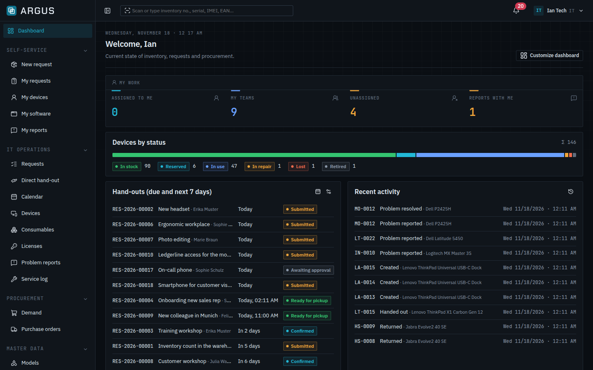
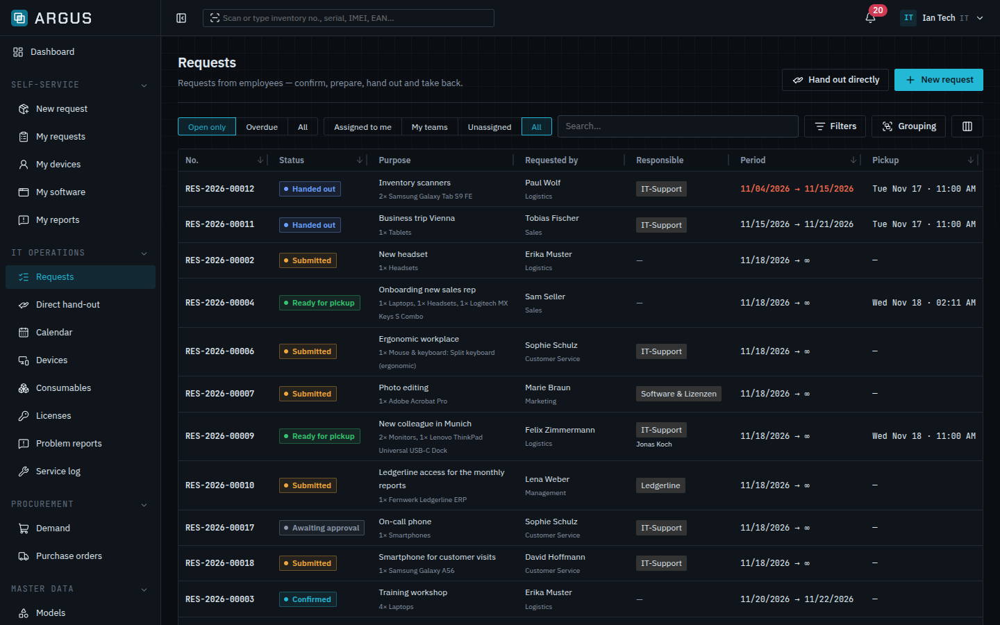

# Argus

IT asset management for an in-house IT department. Argus keeps the inventory of devices,
consumables and software licenses, and takes employee requests through every step: from
request and approval to preparation, a signed handover and the return. Missing devices
turn into purchase orders. Argus is self-hosted with Docker and speaks English and German.

Argus is **vibe-coded**. The code is written by an AI coding agent (Claude Code); a human
decides what Argus should do and tries out every change. Strict typing, an extensive test
suite and automated checks on every commit keep the code in shape.



## Features

### Inventory

- **Devices** are tracked one by one, with inventory number, serial number, IMEI, MAC
  address, location, assignment and warranty. A life cycle log records every hand-out,
  return, repair and battery replacement.
- **Device names** belong to the place, not to the hardware: when a device is replaced,
  its hostname passes to the replacement. Categories can give new devices the next name
  from a number sequence (`pc-{seq}`).
- **Import** devices from Excel or CSV (e.g. an MDM export) with column mapping and a
  preview, or create a series of identical devices in one go.
- **Consumables** such as ink cartridges are counted per location, with minimum
  quantities, stock movements and the models or devices they fit.
- **Software licenses** with seats and terms, assigned to employees or devices, with a
  warning before they expire.
- **Problem reports** from employees about their devices, which IT works through to repair
  or replacement.

### Self-service for employees

- Employees request devices by group ("any headset") or by model, for a period or for
  good, as well as software and consumables that fit their own devices.
- They follow the status and pickup time, see the devices and software they hold, and
  report problems.
- Optional **department approval**: approvers decide on their department's requests
  before IT sees them, and name a delegate while they are away.

### Request workflow for IT

- IT confirms a request (with reduced quantities if needed), assigns a team and person
  in charge and plans the pickup date and place.
- Devices are allocated by scanning, by picking from a list or automatically. IT then
  marks the request ready, hands it out, extends loans and takes devices back; overdue
  returns trigger reminders.
- A **pickup terminal** (a shared touch PC) lists the prepared pickups. The collecting
  person checks the devices, notes any damage and signs on screen; every handover gets a
  printable record. Devices can also be delivered or handed out directly, without a
  prior request.



### Procurement

- Demand that the pool cannot cover, and consumables below their minimum, turn into
  purchase orders.
- Goods receipt with scanned serial numbers creates the devices and allocates them
  straight to the waiting requests.

### Everyday work

- **Barcode scanning** anywhere in the IT views: an inventory number, serial number,
  IMEI or EAN jumps straight to the device or model.
- A dashboard that each user arranges for themselves, and a calendar of loans, pickups,
  returns, deliveries and expiring warranties and licenses.
- **Live updates:** lists, pages and counters refresh by themselves when a colleague
  changes something.
- **Notifications** in the app and by email, from "ready for pickup" to reminders before
  a return is due and before licenses expire; every user chooses which ones they get.
- Configurable number sequences for inventory, request and order numbers.

### Administration and security

- **Roles** grant read or write access per area, so IT staff see only what they work on.
- **LDAP / Active Directory** sign-in with attribute mapping and directory sync, and
  **two-factor authentication** with an authenticator app, codes by email or backup codes.
- Modules and features can be switched off; deadlines and warning periods are
  configurable.
- One hardened container (read-only, unprivileged, strict content security policy) and a
  nightly database backup.

## Quick start with Docker

You need Docker with the Compose plugin. Argus runs from the published image
`ghcr.io/marank/argus`; the server needs only two files.

1. Download `compose.yml` and the example configuration:

   ```bash
   mkdir argus && cd argus
   curl -fsSLO https://raw.githubusercontent.com/marank/argus/main/compose.yml
   curl -fsSL https://raw.githubusercontent.com/marank/argus/main/.env.example -o .env
   ```

2. Edit `.env` and set at least these values:

   | Variable | Value |
   | --- | --- |
   | `SECRET_KEY` | A random string of at least 40 characters. Argus does not start with the placeholder. |
   | `ADMIN_PASSWORD` | Password of the first administrator (user `admin`). |
   | `POSTGRES_PASSWORD` | Password of the database, used only between the containers. |
   | `APP_URLS` | The address users open, e.g. `http://argus.example.com:8080`. Keep `http://localhost:8080` to try it on your own machine. |

   Generate the random values for `SECRET_KEY` and `POSTGRES_PASSWORD` with
   `openssl rand -hex 32`.

   To look around with sample data, also set `APP_DEMO_DATA=true` (all demo users have
   the password `argus-demo`; never on a real instance).

3. Start Argus and its database:

   ```bash
   docker compose up -d
   ```

Open <http://localhost:8080> and sign in as `admin`. Updates:
`docker compose pull && docker compose up -d`; migrations run on every start.

For real use, put a TLS proxy in front and set `TRUSTED_PROXIES`, see
[Installation](docs/en/it/operations/installation.md#behind-a-tls-proxy).

## Documentation

The documentation is in [`docs/`](docs/) and inside every running instance at `/docs/`
(user menu → *Help*), in English and German.

- **Operations:** [installation](docs/en/it/operations/installation.md),
  [all settings](docs/en/it/operations/configuration.md),
  [backups](docs/en/it/operations/backups.md),
  [updates and troubleshooting](docs/en/it/operations/maintenance.md),
  [security](docs/en/it/operations/security.md),
  [LDAP sign-in](docs/en/it/administration/ldap.md)
- **Using Argus:** [for IT staff](docs/en/it/index.md),
  [for employees](docs/en/employees/index.md), [for approvers](docs/en/approvers/index.md)
- **Development:** [setup](docs/en/development/index.md),
  [architecture](docs/en/development/architecture.md),
  [checks and tests](docs/en/development/checks.md)

## Contributing

Bug reports, ideas and pull requests are welcome; see [CONTRIBUTING.md](CONTRIBUTING.md).
To run Argus from source:

```bash
cd backend && uv sync && uv run python manage.py migrate && uv run python manage.py seed_demo && uv run python manage.py runserver
```

```bash
cd frontend && pnpm install && pnpm dev    # http://localhost:5173
```

## License

Argus is licensed under the [GNU Affero General Public License v3.0 or later](LICENSE).
Running a modified Argus for others over a network obliges you to offer them its source.
